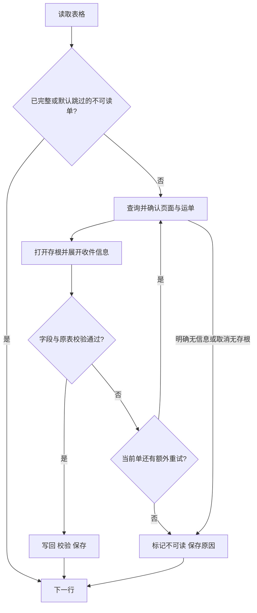

# 实现概览

程序为 C#/.NET Framework WinForms 应用。业务查询使用 Windows UI Automation；表格读写直接处理 XLSX 中的 XML，不依赖 Excel 进程或 AI 服务。

| 文件 | 职责 |
| --- | --- |
| `Program.cs` | 桌面界面、入口、快捷键、日志 |
| `Core.cs` | 任务循环、结果校验、XLSX 保存、备份、续跑状态 |
| `Automation.cs` | 微信控件快照、点击确认、页面导航、字段读取 |
| `UiRules.cs` | 标签、输入框、卡片、小眼睛和取消状态定位 |
| `FailureMarks.cs` | 表内不可读状态及条件格式 |
| `SelfTests.cs` | 文件、恢复和点击反馈测试 |
| `LayoutTests.cs` | 合成控件树和布局测试 |

图中省略了全局停止分支：验证码、访问限制、窗口不可用、文件占用或外部修改等需要停止并保留状态。

点击后会检查目标状态。若原页面仍适用且动作未生效，重新读取控件并有限重试；已经进入新页面则停止点击旧入口。小眼睛的成功条件是当前运单的收件手机号显示完整。

每单回填前验证原表文件哈希，先写临时 XLSX 并读取核对，再替换原文件。姓名/电话使用原有前后缀校验，运单号必须精确匹配。

不可读标记包含运单号。改了运单号，旧标记不再匹配；清除标记后条件格式不再着色。JSON 用于续跑结果和运行状态，不是识别不可读单的唯一依据。
